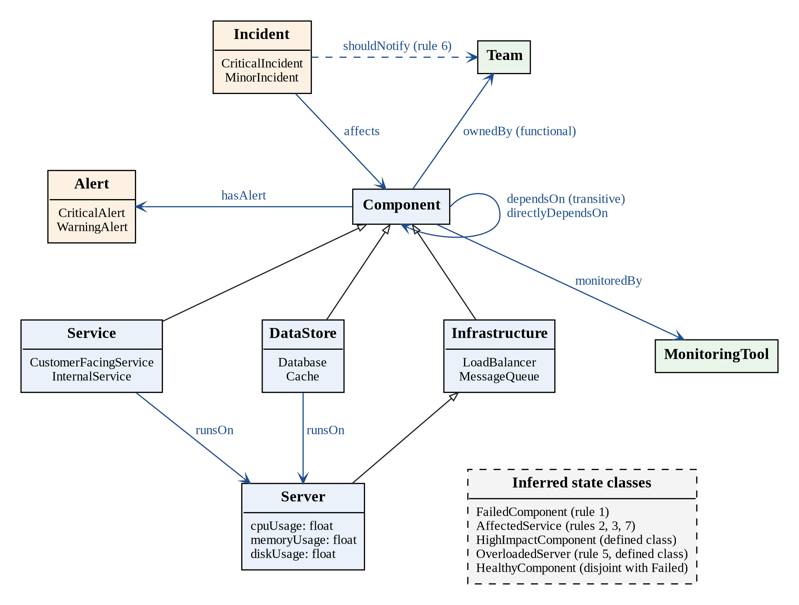
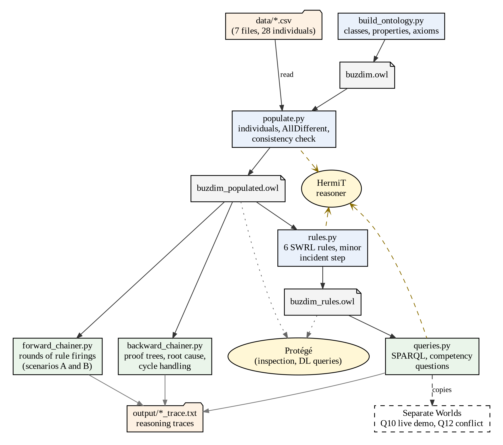

# BuzDim: A Knowledge Representation System for Cloud Incident Diagnosis

BuzDim is an OWL ontology and rule-based reasoning system that diagnoses incidents in cloud infrastructure. Given component facts and monitoring alerts, it infers which components have failed, which services are affected, how severe each incident is, which team to notify, and what the root cause of an outage is.

The system is demonstrated on the infrastructure of a fictional online store, ShopLite: 14 components (services, databases, a cache, servers, a load balancer, and a message queue), plus alerts, incidents, teams, and monitoring tools.

Built for AAI6600 Applied Artificial Intelligence, Northeastern University. Implementation option C: Python with owlready2.

## What the system does

- **Ontology:** 24 classes, 9 object properties, 3 data properties, 8 disjointness axioms, 2 defined classes, and 2 cardinality restrictions
- **Knowledge base:** 28 individuals loaded from CSV files
- **Rules:** 7 production rules (6 in SWRL, plus 1 OWL defined class)
- **Reasoning:** consistency checking and classification with the HermiT reasoner, plus Python forward and backward chaining engines with step-by-step traces
- **Queries:** 8 competency questions, including a SPARQL lookup, a live classification demo, and tests for incomplete and conflicting data

## System at a glance

The conceptual model shows the main classes, their subclasses, and the properties that connect them. Hollow arrowheads are subclass links, blue arrows are object properties, and the dashed box lists the state classes that the rules fill in.



The architecture diagram shows how the scripts run in order, which files they pass along, and which ones call the HermiT reasoner.



## Project structure

```
buzdim/
    README.md
    requirements.txt           pip dependencies (owlready2)
    environment.yml            conda environment (Python 3.11, Java 25)
    run_all.sh                 runs every script in order and saves all traces
    docs/
        buzdim_model.md        full design: classes, axioms, rules, data, expected answers
        figures/
            conceptual_model.dot       Graphviz source for the conceptual model
            conceptual_model.png       conceptual model diagram (report Figure 1)
            system_architecture.dot    Graphviz source for the architecture diagram
            system_architecture.png    architecture diagram (report Figure 4)
    data/                      sample data files (the ShopLite individuals)
        components.csv
        server_metrics.csv
        dependencies.csv
        alerts.csv
        incidents.csv
        teams.csv
        monitoring_tools.csv
    src/
        smoke_test.py          checks that both reasoners can run
        build_ontology.py      builds classes, properties, and axioms
        populate.py            adds the individuals from data/
        rules.py               adds the SWRL rules and runs the reasoner
        forward_chainer.py     data-driven rule engine with round-by-round traces
        backward_chainer.py    goal-driven root cause analysis with proof traces
        queries.py             answers the competency questions
        reproduce_before_rule7.py  runs the rules without rule 7 to show the HermiT limitation
    output/                    ontology files and reasoning traces
    screenshots/               Protege views of the ontology
        01_class_hierarchy_asserted.JPG        class tree as designed
        02_class_hierarchy_inferred.JPG        class tree after reasoning (no unsatisfiable classes)
        03_dl_query_high_impact_component.JPG  DL query returning orders_db
        04_dl_query_overloaded_server.JPG      DL query returning server_d
        05_object_properties.JPG               directlyDependsOn: subproperty, inverse, not transitive
        06_individuals.JPG                     orders_db with its asserted and inferred facts
```

## Requirements

- **Python 3.11** (3.8 or newer works)
- **owlready2 0.51**
- **Java 25.** owlready2 runs its reasoners in Java. HermiT works on Java 17 or newer, but the Pellet reasoner bundled with owlready2 0.51 requires Java 25. With an older Java, Pellet fails with an `UnsupportedClassVersionError`.
- **Protege 5.x** (optional) to view the `.owl` files
- **Graphviz** (optional) only to redraw the diagrams in `docs/figures/`. It is not needed to run the project.

## Setup

These steps use conda, which also installs Java inside the environment.

```bash
conda env create -f environment.yml
conda activate buzdim
pip install -r requirements.txt
java -version
python src/smoke_test.py
```

`java -version` should report version 25, and the smoke test should print `HermiT works` and `Pellet works`.

**Without conda:** install Python 3.11 and a Java 25 runtime (such as Eclipse Temurin 25, with "Add to PATH" selected), then run `pip install -r requirements.txt`.

Java is only available while the `buzdim` environment is active, so run `conda activate buzdim` in every new terminal, and run scripts from the terminal rather than an editor's Run button.

## Running the system

Run everything from the project root folder.

**Option 1: run everything at once**

```bash
bash run_all.sh
```

This runs all six scripts in order, prints their output, and saves each trace to `output/`.

**Option 2: run the scripts one by one**

The order matters, because each script uses the file saved by the one before it.

```bash
python src/build_ontology.py     # creates output/buzdim.owl
python src/populate.py           # creates output/buzdim_populated.owl
python src/rules.py              # creates output/buzdim_rules.owl
python src/forward_chainer.py    # needs buzdim_populated.owl
python src/backward_chainer.py   # needs buzdim_populated.owl
python src/queries.py            # needs buzdim_rules.owl
```

Every script prints its results next to the expected answers from the design file, so each run checks itself.

## The scripts

**build_ontology.py** builds the ontology structure: the class hierarchy, object and data properties, disjointness axioms, the two defined classes (`OverloadedServer` and `HighImpactComponent`), and cardinality restrictions. It prints counts (24 classes, 9 object properties, 3 data properties) and saves `output/buzdim.owl`.

**populate.py** loads the structure, reads the CSV files in `data/`, creates the 28 individuals and their links, declares them all distinct, and saves `output/buzdim_populated.owl`. It then runs HermiT as a consistency check, which already classifies orders_db as a `HighImpactComponent` and server_d as an `OverloadedServer` from the class definitions alone.

**rules.py** adds the six SWRL rules, saves `output/buzdim_rules.owl`, runs HermiT, and assigns minor incidents in a closed-world Python step.

**forward_chainer.py** applies all seven rules in rounds until nothing new can be inferred, printing each rule firing and the facts behind it. Scenario A uses the main data. Scenario B adds a critical alert on server_a to show rule 3 firing.

**backward_chainer.py** starts from a goal, such as "is checkout_service affected?", and works backward through the rules to prove it, then identifies the root cause. It runs four investigations, including a goal that cannot be proven and a circular dependency.

**queries.py** answers the competency questions, using SPARQL for the lookup query. It also adds two new servers in a separate copy to show automatic classification, and runs the conflicting data test in another separate copy.

## Production rules

| # | Rule | Implemented in |
|---|---|---|
| 1 | A component with a critical alert is failed | SWRL, Python |
| 2 | A service that depends on a failed component is affected | SWRL, Python |
| 3 | A service running on a failed server is affected | SWRL, Python |
| 4 | An incident affecting a customer-facing service is critical | SWRL, Python |
| 5 | A server with CPU usage above 90% is overloaded | OWL defined class, Python |
| 6 | An incident notifies the team that owns the affected component | SWRL, Python |
| 7 | A service that depends on an affected service is also affected | SWRL, Python |

Incidents not proven critical are then classified as minor, in a Python step after reasoning.

## Competency questions

| CQ | Question | Answered by | Result |
|---|---|---|---|
| CQ1 | Which monitoring tool watches each server? | `queries.py` (SPARQL) | server_a, server_b: cloudwatch. server_c, server_d: prometheus |
| CQ2 | Which services are affected if orders_db fails? | `rules.py`, `queries.py`, `forward_chainer.py` | checkout, payment, inventory directly. web_frontend indirectly. search_service not affected |
| CQ3 | What is the root cause of the checkout_service outage? | `backward_chainer.py` | orders_db |
| CQ4 | Which components are depended on by 3 or more services? | `queries.py` | orders_db only |
| CQ5 | Which incidents are critical and which are minor? | `queries.py`, `forward_chainer.py` | Critical: inc_001, inc_004. Minor: inc_002, inc_003 |
| CQ6 | How is a server classified by CPU usage? | `queries.py` | server_d overloaded. New server_e (91.5) overloaded, server_f (90.0) not |
| CQ7 | Which components have no monitoring data? | `queries.py` | order_queue |
| CQ8 | What happens with conflicting health data? | `queries.py` | Inconsistency detected |

## Example usage

Asking the backward chainer why checkout_service is affected produces a proof tree:

```
Goal: AffectedService(checkout_service)?
  Try rule 2: checkout_service depends on orders_db
    Goal: FailedComponent(orders_db)?
      Rule 1: orders_db has critical alert alert_001. PROVEN
  ...
Root cause analysis:
  orders_db IS a root cause: nothing it relies on has failed (checked: ['server_c'])
Root cause(s): ['orders_db']
```

The forward chainer shows how one alert spreads through the system, one round at a time:

```
Round 1
  Rule 1 fired: orders_db has critical alert alert_001
          => FailedComponent(orders_db)
Round 2
  Rule 2 fired: checkout_service depends on failed component orders_db
          => AffectedService(checkout_service)
Round 3
  Rule 7 fired: web_frontend depends on affected service checkout_service
          => AffectedService(web_frontend)
```

To try a new scenario, add a row to `data/alerts.csv` (for example, a `CriticalAlert` on `server_b`), then rerun `populate.py`, `rules.py`, and `forward_chainer.py` to see which services are affected.

## Outputs

| File | Contents |
|---|---|
| `output/buzdim.owl` | Ontology structure only |
| `output/build_trace.txt` | Class and property counts from building the structure |
| `output/buzdim_populated.owl` | Structure plus the 28 individuals |
| `output/buzdim_rules.owl` | Populated ontology plus the SWRL rules (open in Protege to rerun the rules) |
| `output/populate_trace.txt` | Counts and the first consistency check |
| `output/rules_trace_before_rule7.txt` | Reasoner results before rule 7 was added, showing the limitation described below |
| `output/rules_trace.txt` | Reasoner results with all rules |
| `output/forward_chaining_trace.txt` | Forward chaining rounds for scenarios A and B |
| `output/backward_chaining_trace.txt` | Backward chaining proof trees for all four investigations |
| `output/queries_trace.txt` | Answers to the competency questions |

## Notable finding: transitive properties and SWRL rules

Rule 2 originally relied on the transitive `dependsOn` property to reach services that depend on a failed component indirectly. In testing, HermiT applied the rule only to direct dependencies: it does not pass links derived from transitivity into SWRL rules, so web_frontend was not marked as affected (see `output/rules_trace_before_rule7.txt`). Rule 7 was added to spread impact one dependency at a time, which also models how failures cascade through real systems. Python's own calculation (`INDIRECT_dependsOn`) confirms the full dependency chain exists.

## Editing the diagrams

The two diagrams are drawn by Graphviz from the `.dot` files in `docs/figures/`. Each box and arrow is one line of text, so a diagram can be changed by editing that file. To redraw one, install Graphviz (on Windows, use the installer from graphviz.org and choose "Add Graphviz to the system PATH"), then run from the project root:

```bash
dot -Tpng docs/figures/conceptual_model.dot -o docs/figures/conceptual_model.png
dot -Tpng docs/figures/system_architecture.dot -o docs/figures/system_architecture.png
```

If a redrawn image comes out wrong, `git restore docs/figures/<file>.png` brings back the committed version.

## Troubleshooting

- **`conda: command not found` in Git Bash on Windows:** run `source ~/miniconda3/etc/profile.d/conda.sh` (or `~/anaconda3/...`), then `conda init bash`, and open a new terminal.
- **`java: command not found`:** activate the environment with `conda activate buzdim`.
- **`UnsupportedClassVersionError` from Pellet:** Java is older than version 25. Run `conda install -c conda-forge openjdk=25`.
- **`FileNotFoundError`:** a script was run out of order, or from the wrong folder. Run the scripts from the project root in the order above.
- **`'X' was not found in the ontology`:** a name in one of the CSV files has a typo.
- **Large conda downloads fail with `CondaHTTPError`:** run `conda config --set remote_read_timeout_secs 120` and `conda config --set remote_max_retries 5`, then retry.

## Acknowledgements

Code and design were developed with the assistance of Claude (Anthropic), as cited in the accompanying report. The ontology is built with owlready2 (Lamy, 2017) and reasoned over with HermiT.
